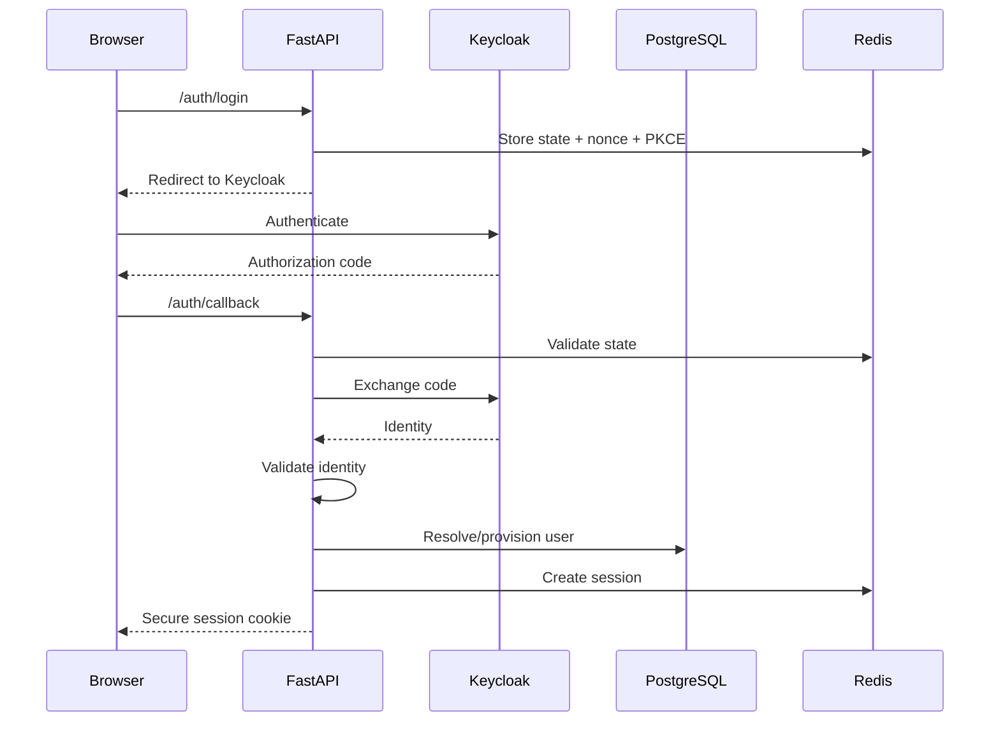

# Authentication Architecture

## 1. Purpose

This document defines authentication, identity mapping, application sessions, and role resolution for Usher Library.

Authentication is delegated to Keycloak. Application authorization remains owned by Usher Library.

---

## 2. Authentication Model

```text id="2z5d2n"
Browser
   ↓
FastAPI
   ↓
Keycloak / OIDC
   ↓
FastAPI
   ↓
Application Session
   ↓
Browser Cookie
```

Protocol:

```text id="24n5b7"
OpenID Connect
Authorization Code
PKCE
```

The backend mediates the authentication flow.

Long-lived Keycloak tokens are not exposed to browser application code.

---

## 3. Responsibilities

### Keycloak owns

- authentication
- passwords
- password recovery
- MFA
- external identity
- identity-provider account state

### Usher Library owns

- application user
- username
- display name
- application role
- application status
- visual preferences
- application sessions
- authorization

---

## 4. Keycloak Client

The application uses a confidential OIDC client.

Required:

```text id="v6db1p"
Authorization Code
PKCE
client authentication
exact redirect URIs
HTTPS in production
```

The client secret exists only on the backend.

It must never appear in frontend code or browser responses.

---

## 5. Login Flow



The callback must reject:

- invalid state
- invalid nonce
- invalid PKCE
- invalid authorization code
- invalid issuer/audience
- expired identity data

---

## 6. Identity Validation

The backend validates the OIDC identity, including:

```text id="90d1b4"
issuer
signature
expiration
audience/client
nonce
```

The application identifies the external user primarily through:

```text id="mnxwcf"
OIDC sub
```

The `sub` maps to:

```text id="7z6sq5"
users.keycloak_subject
```

Application foreign keys use:

```text id="s3iw4l"
users.id
```

---

## 7. User Provisioning

After successful authentication:

```text id="b46c7f"
Keycloak identity
      ↓
keycloak_subject lookup
      ↓
existing user?
  ├── yes → load user
  └── no  → create user
```

New users receive:

```text id="q1jnyr"
role   = READER
status = active
```

Users must never receive `ADMIN` automatically.

Username/display-name provisioning must handle collisions safely.

---

## 8. Application Roles

Initial roles:

```text id="0wuszh"
READER
ADMIN
```

Roles belong to the application and are stored in PostgreSQL.

Keycloak authenticates the identity but does not define normal application permissions.

Users cannot assign or modify their own role.

---

## 9. Account Status

Initial statuses:

```text id="jfmm7r"
active
suspended
```

Suspended users cannot perform authenticated application actions.

Suspension should invalidate active application sessions.

---

## 10. Application Sessions

The application uses server-side sessions.

The browser receives only an opaque session identifier.

Session data includes at minimum:

```text id="2e2ly5"
session_id
user_id
created_at
expires_at
```

Redis is the preferred session store.

Redis remains ephemeral; PostgreSQL remains the source of truth for user/domain data.

---

## 11. Session Cookie

Production cookies must use:

```text id="f0ujgb"
HttpOnly
Secure
SameSite=Lax
Path=/
```

Session IDs must be:

- random
- opaque
- non-sequential
- unrelated to user IDs

---

## 12. Session Lifetime

Initial defaults:

```text id="u0v1u8"
Idle timeout:      30 minutes
Absolute timeout:  7 days
```

Values are configurable.

Sessions must support explicit revocation.

---

## 13. Session Rotation

After successful authentication:

```text id="zj69cz"
old/anonymous session
        ↓
invalidate
        ↓
new authenticated session
```

This prevents session fixation.

---

## 14. Session Validation

Protected requests follow:

```text id="6qdrtj"
cookie
 ↓
session lookup
 ↓
valid?
 ↓
application user
 ↓
status check
 ↓
authorization
```

Expired, revoked, or invalid sessions return `401`.

Suspended users cannot use an existing session.

---

## 15. Logout

Logout must:

1. invalidate the application session
2. clear the session cookie
3. optionally terminate the Keycloak SSO session

Application logout must succeed even if provider logout fails.

Endpoint:

```text id="akztld"
POST /auth/logout
```

---

## 16. Session Revocation

Sessions must be revocable for:

- logout
- account suspension
- security incidents
- role changes
- suspected account compromise

Implementation may use individual session records or a user/session-version mechanism.

---

## 17. Authentication Endpoints

Initial authentication surface:

```text id="1avbvn"
GET  /auth/login
GET  /auth/callback
POST /auth/logout
GET  /auth/me
```

Credential management endpoints are not implemented by Usher Library.

---

## 18. Login Security

The login flow requires:

```text id="s8q7vv"
state
nonce
PKCE
TLS
exact redirect URI
```

Temporary authentication state must be:

- cryptographically random
- short-lived
- single-use

Arbitrary callback/return URLs are prohibited.

---

## 19. `/auth/me`

Returns only application-level user information.

Example:

```json id="zcnlnc"
{
  "id": "uuid",
  "username": "reader42",
  "display_name": "Reader",
  "role": "READER",
  "status": "active"
}
```

It must not expose:

- Keycloak subject
- access tokens
- refresh tokens
- session IDs
- private provider metadata

---

## 20. CSRF

Because authentication uses cookies, unsafe requests require CSRF protection.

Baseline:

```text id="xu73ku"
SameSite cookies
Origin validation
CSRF token where required
```

Authentication must not bypass the API's normal CSRF policy.

---

## 21. Same-Origin Deployment

Preferred production structure:

```text id="l7r7f8"
https://example.com/
          → React

https://example.com/api/*
          → FastAPI

https://example.com/auth/*
          → FastAPI
```

This minimizes CORS and authentication complexity.

If cross-origin authentication is introduced, it requires explicit security review.

---

## 22. Token Handling

Tokens received from Keycloak:

- remain server-side where possible
- are never logged
- are never returned by `/auth/me`
- are never stored in localStorage/sessionStorage
- are not included in ordinary API responses

Refresh tokens require especially restrictive handling.

---

## 23. Authentication Failures

Authentication must fail closed.

Examples:

```text id="i7dh30"
invalid state
invalid nonce
invalid PKCE
invalid code
wrong issuer
wrong audience
expired identity
suspended account
expired session
revoked session
```

No failed authentication flow may produce an authenticated application session.

---

## 24. Keycloak / Infrastructure Failures

### Keycloak unavailable

```text
new login → fail safely
```

The application must not fabricate identity.

### Redis unavailable

Authenticated requests should fail closed if the session cannot be reliably validated.

Public reading can continue.

### PostgreSQL unavailable

Protected operations must not fall back to guessed or stale authorization state.

---

## 25. Admin Authentication

Admins use the same authentication flow but require:

```text id="9w3jcj"
authenticated
+
active
+
role == ADMIN
```

MFA through Keycloak is recommended for administrative accounts.

Administrative actions must be audited.

---

## 26. Role Changes

Changing roles is security-sensitive.

After:

```text id="g5dq8b"
READER → ADMIN
```

existing sessions must be invalidated or re-evaluated so stale privileges cannot persist unexpectedly.

All role changes must be audited.

---

## 27. Identity Abstraction

Backend application code should not depend directly on Keycloak/OIDC token structures.

Use an internal identity abstraction, for example:

```python id="t2rgc5"
AuthenticatedUser(
    id=...,
    role=...,
    status=...
)
```

Keycloak-specific handling belongs at the authentication/infrastructure boundary.

---

## 28. Authentication Logging

Log security events such as:

```text id="jy7zzn"
login_success
login_failure
logout
session_revoked
user.suspended
user.role_changed
```

Never log:

- passwords
- authorization codes
- access tokens
- refresh tokens
- session cookies
- client secrets

---

## 29. Security Testing

Required tests include:

### Login

- successful login
- invalid state
- invalid nonce
- invalid PKCE
- invalid code
- invalid issuer/audience

### Sessions

- expired session
- revoked session
- logout
- session fixation prevention
- suspended user

### Authorization

- reader cannot access admin action
- reader cannot modify another user
- reader cannot assign admin role
- role changes invalidate/re-evaluate sessions

---

## 30. Authentication Invariants

1. Keycloak authenticates identities.
2. Usher Library owns application authorization.
3. Application users are mapped through `keycloak_subject`.
4. Application foreign keys use internal user UUIDs.
5. Passwords are never stored by the application.
6. Long-lived tokens are never stored in browser storage.
7. Sessions use unpredictable opaque identifiers.
8. Authentication cookies are `Secure` and `HttpOnly`.
9. Login requires state, nonce, and PKCE validation.
10. Redirect URIs are explicit.
11. Open redirects are prohibited.
12. Users cannot self-assign privileged roles.
13. Suspended users cannot perform protected operations.
14. Sessions can be revoked.
15. Authentication failures fail closed.

---

## 31. Related Documents

```text id="4jcb75"
overview.md
system.md
database.md
security.md
infrastructure.md
decisions/ADR-*.md
```

Agents should load only the authentication sections relevant to the current task.