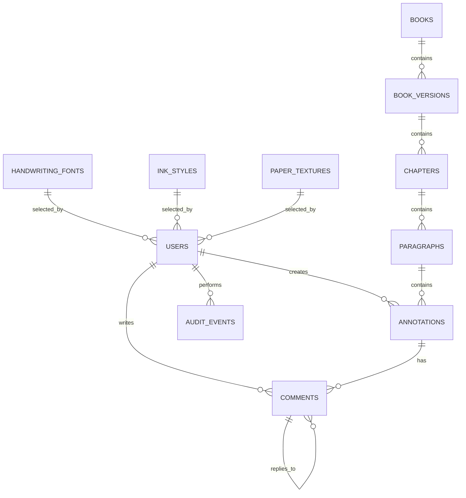

# Database Architecture

## 1. Purpose

This document defines the persistent data model and database invariants for Usher Library.

PostgreSQL is the authoritative source of application data.

Detailed migration procedures belong to the implementation/infrastructure documentation.

---

## 2. Core Principles

1. PostgreSQL is the source of truth.
2. Core relationships use relational tables and foreign keys.
3. Core entities use UUID primary keys.
4. Timestamps use `TIMESTAMPTZ` in UTC.
5. Published book content is immutable.
6. Annotation locations use text ranges, never page coordinates.
7. Critical invariants are enforced at the database level when practical.
8. Redis is never authoritative.
9. User-generated content is soft-deletable where historical integrity matters.
10. Schema changes require Alembic migrations.

---

## 3. Entity Model



Core hierarchy:

```text
Book
 └── BookVersion
      └── Chapter
           └── Paragraph
                └── Annotation
                     └── Comment
                          └── Reply
```

---

## 4. Users

### `users`

| Column | Type | Constraints |
|---|---|---|
| `id` | UUID | PK |
| `keycloak_subject` | VARCHAR | UNIQUE, NOT NULL |
| `username` | VARCHAR | UNIQUE, NOT NULL |
| `display_name` | VARCHAR | NOT NULL |
| `role` | VARCHAR | NOT NULL |
| `status` | VARCHAR | NOT NULL |
| `handwriting_font_id` | UUID | FK |
| `ink_style_id` | UUID | FK |
| `paper_texture_id` | UUID | FK |
| `created_at` | TIMESTAMPTZ | NOT NULL |
| `updated_at` | TIMESTAMPTZ | NOT NULL |

Roles:

```text
READER
ADMIN
```

Statuses:

```text
active
suspended
```

Passwords are not stored here.

`keycloak_subject` is the external identity mapping; application foreign keys use `users.id`.

---

## 5. Reference Style Tables

### `handwriting_fonts`

```text
id
slug UNIQUE
display_name
asset_path
is_active
created_at
```

### `ink_styles`

```text
id
slug UNIQUE
display_name
asset_path
is_active
created_at
```

### `paper_textures`

```text
id
slug UNIQUE
display_name
asset_path
is_active
created_at
```

These are reference data. Stable slugs should be used for deterministic seeding.

---

## 6. Books

### `books`

```text
id UUID PK
slug UNIQUE
title
author
source_name
source_url
license
created_at
updated_at
```

The initial system contains one book, but the schema supports multiple books.

---

## 7. Book Versions

### `book_versions`

```text
id UUID PK
book_id UUID FK
version_number INTEGER
content_hash CHAR(64)
status
published_at
created_at
```

Constraint:

```text
UNIQUE(book_id, version_number)
```

Statuses:

```text
draft
published
archived
```

Published versions are immutable.

Changing canonical text requires a new version.

---

## 8. Chapters

### `chapters`

```text
id UUID PK
book_version_id UUID FK
chapter_number INTEGER
title
position INTEGER
created_at
```

Constraints:

```text
UNIQUE(book_version_id, chapter_number)
UNIQUE(book_version_id, position)
```

`position` defines canonical ordering.

---

## 9. Paragraphs

### `paragraphs`

```text
id UUID PK
chapter_id UUID FK
position INTEGER
text TEXT
text_hash CHAR(64)
created_at
```

Constraint:

```text
UNIQUE(chapter_id, position)
```

Published paragraph text is immutable.

The database stores canonical plain text, not rendered HTML.

---

## 10. Annotation Location

An annotation references a text range inside a paragraph:

```text
paragraph_id
start_offset
end_offset
```

Ranges are half-open:

```text
[start_offset, end_offset)
```

Therefore:

```text
start_offset >= 0
end_offset > start_offset
```

and:

```text
[10,20)
[20,30)
```

do not overlap.

---

## 11. Offset Convention

Offsets use **UTF-16 code-unit indexes**.

This matches browser/JavaScript text indexing and avoids inconsistencies between frontend selection ranges and backend validation.

No component may reinterpret offsets as:

- UTF-8 bytes
- Unicode code points
- grapheme indexes

The convention is global and immutable.

---

## 12. Annotations

### `annotations`

```text
id UUID PK
paragraph_id UUID FK
user_id UUID FK

start_offset INTEGER
end_offset INTEGER

selected_text TEXT
kind VARCHAR
body TEXT NULL

created_at TIMESTAMPTZ
updated_at TIMESTAMPTZ
deleted_at TIMESTAMPTZ NULL
```

Kinds:

```text
highlight
note
```

Invariant:

```text
highlight → body IS NULL
note      → body IS NOT NULL
```

The backend must validate that the range belongs to the referenced paragraph and that `end_offset` does not exceed its UTF-16 length.

---

## 13. Annotation Integrity

`selected_text` is a denormalized snapshot used for integrity/debugging.

It is **not** the canonical location.

Canonical location:

```text
paragraph_id
start_offset
end_offset
```

The exact same range cannot be annotated twice by the same user:

```text
UNIQUE(
    paragraph_id,
    user_id,
    start_offset,
    end_offset
)
```

Overlapping but different ranges are valid.

Changing an annotation's range should create a new annotation rather than mutating its location.

---

## 14. Annotation Indexes

Required:

```text
INDEX annotations(paragraph_id)

INDEX annotations(
    paragraph_id,
    start_offset,
    end_offset
)

INDEX annotations(
    user_id,
    created_at
)
```

Specialized range indexes should only be introduced after measured performance need.

---

## 15. Comments

### `comments`

```text
id UUID PK
annotation_id UUID FK
user_id UUID FK
parent_comment_id UUID FK NULL

body TEXT
moderation_status VARCHAR

created_at TIMESTAMPTZ
updated_at TIMESTAMPTZ
deleted_at TIMESTAMPTZ NULL
```

Comments belong to annotations.

Replies use `parent_comment_id`.

A reply must belong to the same annotation as its parent.

Moderation states initially:

```text
visible
hidden
```

---

## 16. Comment Indexes

Required:

```text
INDEX comments(annotation_id, created_at)

INDEX comments(user_id, created_at)

INDEX comments(parent_comment_id)
```

---

## 17. Audit Events

### `audit_events`

```text
id UUID PK
actor_user_id UUID FK NULL
action VARCHAR
target_type VARCHAR
target_id UUID NULL
metadata JSONB NULL
created_at TIMESTAMPTZ
```

Examples:

```text
user.suspended
user.role_changed
annotation.deleted
comment.hidden
comment.deleted
```

Audit events are append-only.

Secrets and authentication credentials must never be stored in metadata.

---

## 18. Deletion Policy

Avoid destructive cascades for core domain data.

Preferred behavior:

```text
Published books/versions → archive
Annotations               → soft delete
Comments                  → soft delete
Users                     → suspend/anonymize through explicit workflow
```

Foreign-key relationships should generally use restrictive deletion behavior.

Historical discussion structure must remain coherent.

---

## 19. Referential Integrity

Required hierarchy:

```text
Book
 ↓
BookVersion
 ↓
Chapter
 ↓
Paragraph
 ↓
Annotation
 ↓
Comment
```

An annotation must never reference content outside its paragraph/version.

Database constraints and application validation must work together to enforce this.

---

## 20. Transactions

Domain mutations use PostgreSQL transactions.

Examples:

```text
Create annotation
 → validate
 → enforce uniqueness
 → persist
 → commit
```

```text
Create comment
 → validate annotation
 → validate parent
 → persist
 → commit
```

A Redis failure must not invalidate or partially roll back committed domain data.

---

## 21. Indexing Strategy

Indexes must correspond to actual access patterns.

Primary patterns:

```text
book → version → chapters → paragraphs
paragraph → annotations
annotation → comments
user → annotations/comments
```

Avoid indexes added without a concrete query/use case.

---

## 22. Pagination

Potentially unbounded collections require pagination:

- comments
- user annotations
- audit data
- moderation data

Book content may be loaded by chapter or viewport-sized ranges.

---

## 23. Concurrency

Database constraints are authoritative for race-sensitive rules.

For example, duplicate annotations must be prevented by the unique constraint even when two requests arrive concurrently.

Do not rely on:

```text
SELECT
then
INSERT
```

as the sole duplicate-prevention mechanism.

---

## 24. Caching

Redis may cache derived or public data such as:

```text
book metadata
published content
public profile presentation data
```

Redis may also store:

```text
sessions
rate-limit state
future pub/sub data
```

Any Redis value must be reconstructible or recoverable from authoritative data.

---

## 25. Book Ingestion

Canonical content follows:

```text
Project Gutenberg source
        ↓
ingestion
        ↓
normalization
        ↓
BookVersion
        ↓
Chapter
        ↓
Paragraph
```

Each version should record a SHA-256 content hash.

Published content must never be modified through ordinary application APIs.

---

## 26. Migration Strategy

Alembic manages schema changes.

Rules:

1. Every schema change requires a migration.
2. Migrations are committed with dependent application code.
3. Destructive changes require explicit review.
4. Production migrations must be tested.
5. Large data migrations should be separated from ordinary schema changes.
6. Prefer expand → migrate → contract for incompatible changes.

---

## 27. ORM

SQLAlchemy may be used for persistence.

ORM models are persistence models, not automatically domain models or API contracts.

Business logic should not depend directly on SQLAlchemy-specific behavior where avoidable.

API responses must use explicit schemas rather than serializing ORM objects blindly.

---

## 28. Data Integrity Hierarchy

```text
Database constraints
        ↓
Domain/application validation
        ↓
API validation
        ↓
Frontend validation
```

Frontend validation is for UX.

It is never the final integrity boundary.

---

## 29. Anti-Patterns

Do not:

- store page coordinates for annotations
- use selected text as the canonical annotation location
- store core relationships as JSON
- use Redis as persistent truth
- modify published book text in place
- rely on destructive cascade deletes
- expose ORM models directly as API responses
- introduce speculative tables for future features

---

## 30. Initial Schema

```text
users
handwriting_fonts
ink_styles
paper_textures

books
book_versions
chapters
paragraphs

annotations
comments

audit_events
```

Deferred until required:

```text
follows
likes
notifications
reading_progress
reading_sessions
private_messages
recommendations
analytics_events
```

---

## 31. Database Invariants

1. PostgreSQL is authoritative.
2. Core entities use UUIDs.
3. Published book content is immutable.
4. Annotation ranges use UTF-16 half-open offsets.
5. Annotation ranges belong to a specific paragraph/version.
6. Exact duplicate annotations by the same user are prohibited.
7. Comments belong to annotations.
8. Replies belong to the same annotation as their parent.
9. Redis is never authoritative.
10. User-generated content can be soft-deleted.
11. Schema changes require Alembic migrations.
12. Critical integrity rules should be enforced by database constraints.
13. Visual concepts such as pages and coordinates are never canonical database state.