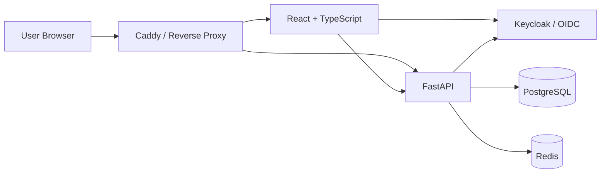

# Architecture Overview

## 1. Purpose

Usher Library is a collaborative literary reading platform centered on *The Fall of the House of Usher* by Edgar Allan Poe.

Anyone can read the book. Authenticated users can highlight passages, create annotations, comment on annotations, and customize their reader identity.

The architecture is designed for one book initially while supporting additional books later without a fundamental redesign.

---

## 2. Scope

### Initial scope

- Public book reading.
- Desktop two-page and continuous reading modes.
- Responsive mobile reading.
- Text highlighting.
- Text annotations.
- Contextual comments and replies.
- Public reader profiles.
- Per-user handwriting, ink, and texture styles.
- Annotation-density visualization.
- Authentication and authorization.
- Moderation.
- Dockerized development and deployment.
- Automated testing and CI/CD.

### Out of scope

- Social following.
- Private messaging.
- Recommendation feeds.
- Native mobile applications.
- User-uploaded books.
- DRM.
- Full real-time synchronization.
- Microservices.

---

## 3. Architectural Goals

The system prioritizes:

1. **Reading experience** — the book remains the primary interface.
2. **Security** — authorization, session handling, validation, and abuse prevention are first-class concerns.
3. **Maintainability** — clear boundaries between frontend, backend, domain, persistence, and infrastructure.
4. **Performance** — load only the content and annotations required by the current reading context.
5. **Extensibility** — support additional books and future collaborative features.
6. **Testability** — core business rules must be independently testable.
7. **Simplicity** — prefer a modular monolith over unnecessary distributed architecture.

---

## 4. High-Level Architecture



### Components

| Component | Responsibility |
|---|---|
| React + TypeScript | Reader UI, annotations, comments, profile |
| FastAPI | API, application logic, authorization |
| PostgreSQL | Persistent application data |
| Redis | Cache, sessions, future pub/sub/rate limiting |
| Keycloak | Authentication / OIDC |
| Caddy | HTTPS and reverse proxy |
| Docker | Runtime isolation |
| CI/CD | Verification and deployment |

---

## 5. Architecture Style

The backend is a **modular monolith**.

Logical layers:

```text
API
 ↓
Application
 ↓
Domain
 ↓
Infrastructure
```

### API

HTTP routing, request/response handling, authentication context.

### Application

Use cases and workflow orchestration.

### Domain

Business rules and domain concepts.

### Infrastructure

PostgreSQL, Redis, Keycloak, external integrations.

Domain logic must not depend directly on FastAPI, React, PostgreSQL, Redis, or Keycloak.

---

## 6. Core Domain

```text
Book
 └── BookVersion
      └── Chapter
           └── Paragraph
                └── Annotation
                     └── Comment
                          └── Reply
```

Users create annotations and comments.

Annotations reference **text ranges**, not visual page coordinates.

Canonical annotation location:

```text
BookVersion
    ↓
Paragraph
    ↓
start_offset
    ↓
end_offset
```

The frontend derives page layout, margins, markers, and other visual representations from this data.

---

## 7. Book Content

Book content is versioned and effectively immutable after publication.

```text
Book
 └── BookVersion
      └── Chapter
           └── Paragraph
```

Changing published text requires a new book version.

This prevents existing annotations from becoming ambiguous.

Detailed persistence rules:

`docs/architecture/database.md`

---

## 8. Reader Architecture

The reader supports two presentation modes:

### Book mode

Desktop-oriented:

- two-page layout
- real margins
- contextual notes
- annotation-density indicators
- page-wear effects

### Scroll mode

Continuous document:

- desktop or mobile
- no dependency on page coordinates
- suitable for constrained screens

Both modes use the same canonical book content and annotation model.

---

## 9. Annotation Model

Annotations are central domain objects.

Initial types:

```text
highlight
note
```

An annotation contains:

- author
- paragraph
- text range
- selected text snapshot
- type
- optional note body
- timestamps

Overlapping annotations are allowed.

Annotation density is derived from persisted annotations and is used only for presentation.

---

## 10. Discussion Model

Comments belong to annotations.

```text
Annotation
 ├── Comment
 │    ├── Reply
 │    └── Reply
 └── Comment
```

Discussion is contextual to a passage rather than a separate social feed.

---

## 11. Authentication

Authentication is delegated to Keycloak using OpenID Connect.

The application uses a backend-mediated session model.

```text
Browser
   ↓
FastAPI
   ↓
Keycloak
   ↓
FastAPI session
   ↓
Browser cookie
```

Keycloak answers:

> Who is this user?

The application answers:

> What can this user do?

Application roles are owned by Usher Library.

Detailed authentication architecture:

`docs/architecture/authentication.md`

---

## 12. Authorization

Initial application roles:

```text
READER
ADMIN
```

Anonymous users can read public content.

Readers can additionally:

- create highlights
- create annotations
- comment
- reply
- modify their own content
- modify their own profile

Administrators can additionally perform moderation and administrative actions.

Authorization is always enforced server-side.

Detailed security rules:

`docs/architecture/security.md`

---

## 13. Personalization

Reader presentation preferences belong to the application user:

```text
handwriting font
ink style
paper texture
```

These preferences are stored as references to predefined styles.

The frontend owns the actual visual rendering.

Presentation choices must not be embedded into annotation persistence.

---

## 14. Performance

The system should avoid loading the entire book annotation graph at once.

Preferred strategies:

- scoped API requests
- client-side caching
- lazy loading
- pagination where required
- HTTP caching
- Redis caching where useful

Performance optimizations must not bypass authorization or alter canonical text/range semantics.

---

## 15. Real-Time

Real-time synchronization is **not required for the initial release**.

The architecture may later support:

```text
Frontend
   ↓
WebSocket
   ↓
FastAPI
   ↓
Redis Pub/Sub
```

Potential uses:

- live highlights
- live comments
- live annotation-density changes

No real-time infrastructure should be introduced without a concrete feature requirement.

---

## 16. Infrastructure

### Development

```text
Docker Compose
 ├── Frontend
 ├── Backend
 ├── PostgreSQL
 ├── Redis
 └── Keycloak
```

### Production

```text
Internet
   ↓
Caddy
 ├── Frontend
 └── Backend
      ├── PostgreSQL
      ├── Redis
      └── Keycloak
```

PostgreSQL and Redis are private infrastructure services.

---

## 17. Source of Truth

| Concern | Source of truth |
|---|---|
| Identity | Keycloak |
| Application user | PostgreSQL |
| Authorization | PostgreSQL / application |
| Book content | PostgreSQL |
| Annotations | PostgreSQL |
| Comments | PostgreSQL |
| Session | Server-side session store |
| Cache | Redis |
| Page layout | Frontend |
| Annotation density | Derived |
| Visual styles | Frontend + user preferences |

Redis must never be the authoritative source for domain data.

---

## 18. Architectural Principles

1. The backend is the authorization boundary.
2. PostgreSQL is the application data source of truth.
3. Book versions are immutable after publication.
4. Annotation locations are text ranges, never visual coordinates.
5. The browser is untrusted.
6. User-generated content is untrusted.
7. Presentation concerns must not define domain persistence.
8. External services remain behind explicit integration boundaries.
9. New architectural dependencies require an ADR.
10. Prefer simple architecture over speculative infrastructure.

---

## 19. Architecture Documents

| Document | Responsibility |
|---|---|
| `overview.md` | High-level architecture and principles |
| `system.md` | Runtime components and communication |
| `database.md` | Persistence model and constraints |
| `authentication.md` | Identity and session architecture |
| `security.md` | Threat model and security controls |
| `infrastructure.md` | Containers and deployment |
| `decisions/ADR-*.md` | Why architectural decisions were made |
| `specs/*` | Feature requirements and implementation design |

Agents should read only the documents relevant to the current task.

---

## 20. Current State

The architecture is proposed and not yet implemented.

Confirmed technology choices:

```text
Frontend: React + TypeScript + Vite
Backend: FastAPI
Database: PostgreSQL
Cache/Session: Redis
Authentication: Keycloak / OIDC
Proxy: Caddy
Runtime: Docker
CI/CD: GitHub Actions
Architecture: Modular monolith
```