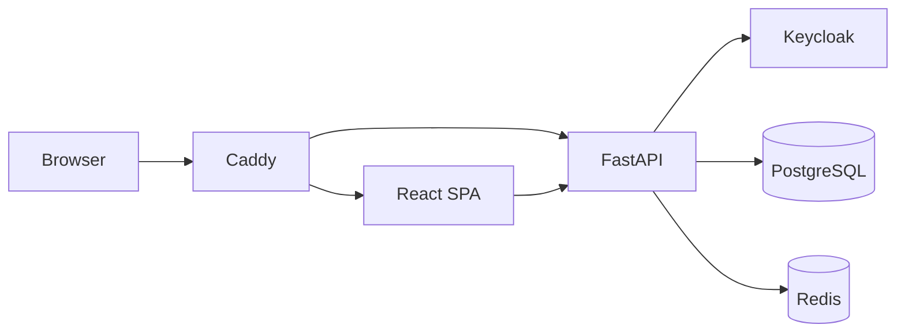
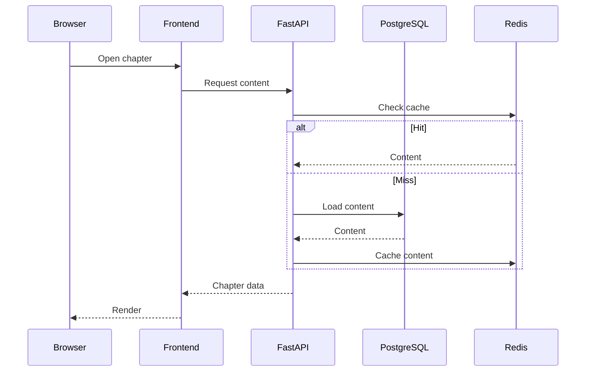
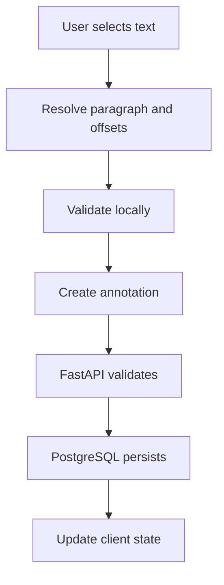

# System Architecture

## 1. Purpose

This document defines the runtime structure of Usher Library:

- system components
- component boundaries
- communication paths
- major request flows
- frontend/backend boundaries
- persistence and caching boundaries

Detailed persistence, authentication, security, and infrastructure rules belong to their dedicated architecture documents.

---

## 2. Runtime Architecture



### Components

| Component | Responsibility |
|---|---|
| Browser | UI and user interaction |
| Caddy | HTTPS, reverse proxy, routing |
| React | Reader and client application |
| FastAPI | API, use cases, authorization |
| PostgreSQL | Persistent domain data |
| Redis | Sessions, cache, future pub/sub |
| Keycloak | Authentication |

---

## 3. Backend Architecture

The backend is a modular monolith.

```text id="bq55tf"
API
 ↓
Application
 ↓
Domain
 ↓
Infrastructure
```

### API

- HTTP routes
- request/response validation
- authentication context
- HTTP error handling

### Application

- use cases
- workflow orchestration
- transaction boundaries

Examples:

```text id="vmh7wa"
CreateAnnotation
CreateComment
UpdateProfile
GetChapter
GetAnnotationThread
```

### Domain

Contains business rules independent of infrastructure.

Examples:

- annotation range validity
- ownership
- comment hierarchy
- book-version consistency

### Infrastructure

Integrations with:

- PostgreSQL
- Redis
- Keycloak
- external services

Domain code must not depend directly on these technologies.

---

## 4. Frontend Architecture

The frontend is organized by feature.

```text id="s0j58h"
frontend/src/
├── app/
├── features/
│   ├── auth/
│   ├── reader/
│   ├── annotations/
│   ├── comments/
│   └── profile/
├── components/
├── hooks/
├── lib/
└── routes/
```

The frontend is responsible for:

- rendering
- text selection
- annotation interaction
- reader modes
- local UI state
- client-side caching

The frontend is never an authorization boundary.

---

## 5. Client Data Flow

Use TanStack Query or equivalent for server state.

```text id="p7et7o"
UI
 ↓
Feature logic
 ↓
Query / mutation layer
 ↓
HTTP client
 ↓
FastAPI
```

Local UI state should remain local unless it must be shared across features.

---

## 6. Public Reading Flow

Public book content does not require authentication.



---

## 7. Authenticated Request Flow

```text id="q2fxmp"
Browser
 ↓
FastAPI
 ↓
Resolve session
 ↓
Resolve application user
 ↓
Authorize operation
 ↓
Execute use case
 ↓
PostgreSQL
 ↓
Response
```

Authorization always occurs before protected mutations.

---

## 8. Authentication Boundary

Authentication is delegated to Keycloak.

```text id="yzt8p8"
Browser
 ↓
FastAPI
 ↓
Keycloak
 ↓
FastAPI
 ↓
Application session
```

The application converts external identity into an internal application user.

Detailed flow:

`docs/architecture/authentication.md`

---

## 9. Reader Architecture

The reader consumes canonical book content and annotations.

```text id="3nf9vs"
Reader
├── Content renderer
├── Text selection
├── Annotation layer
├── Density layer
├── Discussion layer
└── Reading modes
    ├── Book mode
    └── Scroll mode
```

The backend provides content and annotation ranges.

The frontend determines:

- pagination
- margins
- marker positions
- visual density
- page wear
- handwriting rendering

Page coordinates are never persisted.

---

## 10. Annotation Flow



Canonical location:

```text id="qupkfm"
book version
    ↓
paragraph
    ↓
start offset
    ↓
end offset
```

The backend remains authoritative for range validation.

---

## 11. Comment Flow

Comments are always contextual to an annotation.

```text id="2hbyw4"
Annotation
   ↓
Comment thread
   ↓
Replies
```

The frontend loads threads on demand.

Comment creation:

```text id="rdvx48"
Browser
 ↓
FastAPI
 ↓
authorize user
 ↓
validate annotation
 ↓
validate parent comment
 ↓
PostgreSQL
```

---

## 12. Persistence Boundary

PostgreSQL is the authoritative datastore.

```text id="w0qvrn"
FastAPI
 ├── PostgreSQL → source of truth
 └── Redis      → temporary/derived state
```

Redis may contain:

- sessions
- cache
- rate-limit state
- future pub/sub state

A Redis failure must not cause permanent domain-data loss.

---

## 13. Caching

Cache relatively stable public data first:

- book metadata
- published chapters
- paragraphs
- public profile presentation data

Dynamic user content should use appropriate invalidation or short TTLs.

Cache must never bypass authorization.

---

## 14. Consistency

PostgreSQL transactions are used for domain mutations.

Example:

```text id="kszpqf"
Create annotation
 ↓
validate
 ↓
persist
 ↓
commit
```

A successful mutation must not leave partially persisted domain state.

Redis updates are secondary effects.

---

## 15. Error Handling

API errors should use consistent response structures.

Rules:

- `4xx` for client/authorization/validation failures
- `5xx` for unexpected server failures
- no stack traces or secrets in responses
- internal diagnostics go to protected logs

---

## 16. Observability

Application logs should be structured and include, where useful:

```text id="1sri8h"
request_id
timestamp
route
method
status
duration
user_id
error category
```

Never log:

- passwords
- tokens
- session secrets
- client secrets
- sensitive request bodies

Security-sensitive operations should also produce audit events.

---

## 17. Deployment Topology

### Development

```text id="tp1pwa"
Docker Compose
├── Frontend
├── Backend
├── PostgreSQL
├── Redis
└── Keycloak
```

### Production

```text id="1t7j0z"
Internet
 ↓
Caddy
 ├── Frontend
 └── Backend
      ├── PostgreSQL
      ├── Redis
      └── Keycloak
```

Only the required public entry points should be externally reachable.

---

## 18. Failure Behavior

### Redis unavailable

- public reads may continue
- cache performance degrades
- authenticated sessions may fail
- PostgreSQL data remains intact

### Keycloak unavailable

- new login fails
- no new authenticated session may be created

### PostgreSQL unavailable

- mutations fail safely
- data must not be fabricated
- no privileged fallback is allowed

All security failures fail closed.

---

## 19. Architectural Boundaries

The following boundaries must remain explicit:

```text id="46kvht"
Browser
    ↓
HTTP
    ↓
API
    ↓
Application
    ↓
Domain
    ↓
Infrastructure
```

External systems must only be accessed through infrastructure/integration boundaries.

UI concerns must not become persistence concerns.

Database models must not automatically become API contracts.

---

## 20. Architectural Invariants

1. Backend authorization is authoritative.
2. PostgreSQL is the source of truth.
3. Redis is never authoritative.
4. Domain logic does not depend on frameworks.
5. Page/layout information is frontend-derived.
6. Annotation positions are text ranges.
7. Public reading does not require authentication.
8. Protected mutations require authentication and authorization.
9. New infrastructure services require architectural review.
10. Real-time infrastructure is deferred until a concrete requirement exists.

---

## 21. Related Documents

```text id="f8rt9d"
overview.md
database.md
authentication.md
security.md
infrastructure.md
decisions/ADR-*.md
specs/*
```

Agents should read only the documents relevant to the current task.